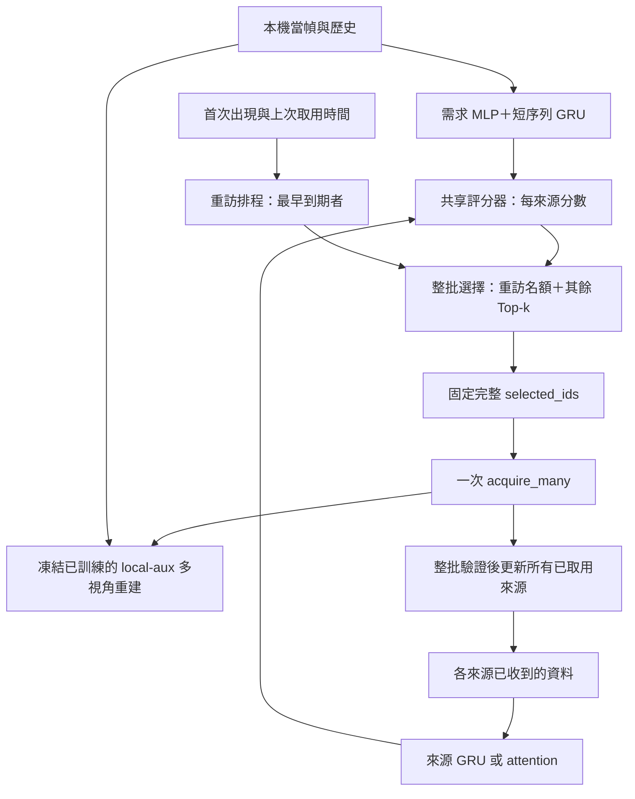

# 一次決定、多來源取用與過期重訪

**另一台主機部署：**先看 [Git clone、環境、資料位置與版本限制](docs/remote_setup.md)。上游版本固定在 `configs/upstream.lock.json`；資料與權重另行下載。目前 local-aux 尚未實作官方預訓練權重移植。

本專案依本機 A 的當幀觀測與真正取得過的歷史，決定向哪些觀測者取得目標 B 的資料。**完整名單先決定，再一次呼叫取用介面；收到第一份資料後不重新選第二人。**v4 新增本機＋輔助視角重建器：以 A 看見 B 的觀測為主分支，不需要 B 自身 tracker；沿用 EgoExoMoCap 空間／時間融合模組與 SMPL-H 輸出。先訓練改版重建器，再凍結它訓練選擇器。

目前是 v4 local-aux 版本，選擇器沿用 v3 批次子集與重訪。**尚無真實 EgoHumans 訓練結果**；新後端仍需授權 SMPL-H、human_body_prior、因果前處理資料與新訓練權重，不使用原版 checkpoint 充當改版權重。[v4 架構、差異、資料與兩階段訓練](docs/local_aux_v4.md)。

## 流程



預設最多2位遠端來源、重訪門檻1秒、到期時保留1個名額；這是**可設定的工程預設，不是實驗得到的最佳值**。本機A不占遠端名額。候選少於預算時全取。新來源第一次出現即進入重訪排程，已收到資料者以「上次取用＋門檻」作為到期時間。一般模型選取也刷新時間；沒有到期來源時不保留重訪名額。

同時到期的人依到期時間排序，最早者先服務，避免低分來源一直被忽略。若候選有限、持續可選、每幀成功同步回傳且重訪啟用，可以限制到期後的等待決策數。門檻不是無條件的延遲上限；丟包、離線或跳過決策不在目前保證範圍。

## 模型與損失

需求編碼器、每來源GRU/attention與共享評分器保留。selection.py負責可替換的集合選擇與獨立重訪規則。現在使用獨立來源分數的Top-k，不宣稱已建模視角互補；未來集合模型可讀PreAcquisitionState中的需求與各來源歷史，但不能讀當幀外部封包。

```text
合法集合 S：大小為 min(k,候選數)，且包含本幀指定重訪來源
z(S) = Σ_{i∈S} z_i
P(S) = softmax over legal subset scores
e(S) = MPJPE(固定重建器(本機、已取得歷史、S的整組當幀封包), GT)
L = Σ_S P(S) × stop_gradient(e(S))
```

成本是實際多視角聯合重建誤差，不是單人誤差相加。訓練先抽取完整集合，再離線計算成本；只有該集合能更新歷史。重建器凍結，沒有教師神經網路。強制重訪名額不學習選擇，剩餘名額仍可受損失訓練。若沒有任何可選集合差異，訓練會明確拒絕，不假裝全取學出了選人。

## 使用

```powershell
python -m unittest discover -s tests -v
python -m observer_selection demo --output runs/my_batch_gru --memory gru --epochs 3 --max-sources 2 --refresh-after-s 1 --refresh-slots 1
python -m observer_selection demo --output runs/my_batch_attention --memory attention --epochs 3 --max-sources 2 --refresh-after-s 1 --refresh-slots 1
python -m observer_selection audit --repo external/EgoExoMoCap
```

demo為合成流程。每次用新目錄。--no-refresh是明確消融，關閉後不保證來源重訪。evaluate從checkpoint還原相同取用/重訪設定，不偷偷改政策。單選可用--max-sources 1；實驗固定k時應有候選數大於k的資料。

本次測試輸出：runs/batch_refresh_gru_v3、runs/batch_refresh_attention_v3；為了短fixture能多次觸發，測試使用0.25秒門檻，並非研究推薦參數。viewer可查看每幀名單、強制重訪、實際請求次數與重建點。

[完整設計與保證](docs/design.md) · [資料契約與實際指令](docs/data_contract.md) · [EgoHumans準備](docs/egohumans_preparation.md)

## 邊界與版本

- checkpoint版本3、objective=expected_subset_mpjpe；v1誤差回歸與v2單來源checkpoint拒絕載入。歷史runs保留，不能與v3混作研究結果。
- 推論Top-k不列舉所有子集；離線訓練/評估使用精確集合期望，超過--max-exact-subsets（預設4096）會報錯，不靜默抽樣或截斷。
- 所有受限baseline採相同預算/重訪規則，另列all全取對照並明示其不同成本。資料很小時，必須用實驗證明選擇的效益，不能憑空假設巨大通訊成本。
- 同步取得整批封包，錯誤/部分回傳不更新任何來源；沒有實作延遲、丟包與頭盔網路服務。acquire_many是一個批次介面，不宣稱封包會在物理上同時抵達。
- `--backend local-aux` 為新預設，移除 B tracker 依賴，要求相機校正與已訓練的 local_aux_v1 checkpoint；SMPL-H 中性 shape 保留。
- `--backend egoexo` 保留原版作對照，仍要求 B tracker 與官方權重，不與新後端混用資料格式。
- 因果歷史視窗、每幀改變來源集合與遮罩的真實重建效果仍待新後端訓練驗證。
