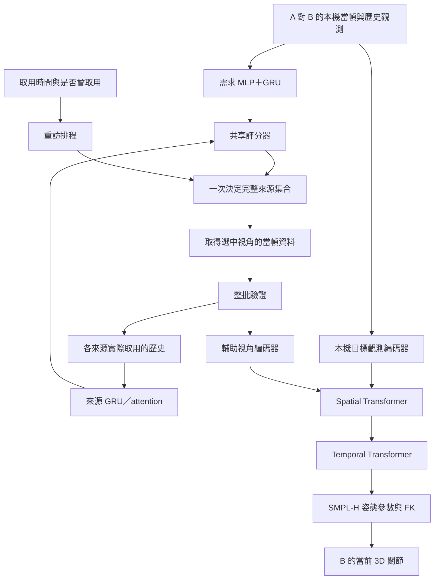

# v4：本機觀測主導的多視角重建

本版依 2026-11-17 討論，新增 local-aux 後端。A 是請求者、B 是被重建者、C/D/E 是候選觀測者。**B 不必提供自身追蹤；A 的影像觀測是主要分支，取用後的其他視角是輔助分支。**不是把 A 的 6DoF 塞進原 EgoNet，也不宣稱與原版預訓練模型等價。

## 哪張圖要改

- 選擇器的網路架構保留：需求 MLP＋GRU、來源 GRU／attention、共享 MLP 評分、整批子集決策與重訪。
- 重建器的網路架構要改：移除 EgoNet／追蹤 embedding，新增本機觀測 token；換掉依賴 B 頭部座標的射線表示。
- 推論流程要改：A 的影像有兩條路，一條供選擇需求，另一條供重建；外部當幀資料在選定後才進重建。
- 訓練流程要改：先訓練改版重建器，再凍結它訓練選擇器。不能載入原版權重後把新分支留在隨機狀態。



## 實作與相對於上游的修改

`local_fusion.py` 載入官方 `networks/egoexomocap.py` 的 FusionNet，保留 ScoreNet、Spatial Transformer、Temporal Transformer、時間位置編碼、root/body 旋轉解碼頭。不上改上游檔案。

| 項目 | 原版後端 | local-aux v1 |
|---|---|---|
| 主分支 | B 的 sparse tracker＋EgoNet | A 看見 B 的關節射線、有效性、confidence 與 DINO |
| 主 token | tracker embedding＋粗姿態 embedding | 118→D→D 的 MLP，加 DINO 768→D；無本機目標框時用 learned missing token |
| 輔助 token | B 頭部座標下的深度縮放射線＋bbox valid | 每關節 origin3＋unit direction3＋valid1＋confidence1＋confidence-known1，加 bbox valid，共 118 維→D |
| 影像品質 | DINO ScoreNet 調制射線 | 保留同一模組類型調制幾何；confidence 僅為帶 mask 的特徵，不是遮蔽 GT |
| 輸出讀取 | 每幀主要 token | 每幀本機 token 經時序處理，只讀最後一幀 |
| 參數初始化 | 官方 checkpoint | 本版從頭訓練；未匯入官方預訓練權重 |
| 人體表示 | SMPL-H | 保留 SMPL-H 前 22 關節與中性 shape |

預設 D=128、spatial/temporal 各 2 層、4 heads、FF=512、window=16。這些是可調實作設定，尚未證明最佳。需求編碼器的 GRU 與重建器的 Temporal Transformer 是不同模組。

主要 token 永遠保留為讀出位置，即使 A 當幀看不到 B，也能讀取已取得的輔助視角與過去時間窗。不生成虛假的本機觀測。未取得或 bbox 無效的 remote token 使用 padding mask。

## 座標與資料假設

每個觀測保留自己的相機內參 K、camera-to-world 變換、13 點像素座標、有效性、選用 confidence、DINO 768 維與 bbox validity。影像／關節必須已校正成與 K 相符的 pinhole 模型，不直接拿魚眼像素套 pinhole。

對視窗最後一幀 t，所有歷史與當幀觀測都轉到 A_t 相機參考系：

```text
T_A(t)_C(s) = inverse(T_world_A(t)) @ T_world_C(s)
direction = normalize(R_A(t)_C(s) @ inverse(K_C(s)) @ [u,v,1])
origin = translation(T_A(t)_C(s))
```

不使用 B 的位置／朝向、不用 B 到相機的距離縮放射線、不讀 B 的 GT betas。相機 pose 需來自相機校正／追蹤，而非 B 的參考骨架。遠端當幀相機資訊放在取用封包中，選擇器不讀；本機只知道自身 pose。共用 world frame 只負責對齊各相機。

輸出為 joint0-root-relative、米制、最後一幀 A 相機的 OpenCV 軸（x 右、y 下、z 前）。GT 先減 joint0，再轉入同一相機方向。這與原版 z-up 結果不是可以直接混用的陣列。MPJPE 不做 Procrustes 對齊，也不衡量 B 在世界中的位置；把骨架定位顯示在頭盔視野仍需另外的全域／相機平移估計，本版未新增。

## 時序

使用截至 t 的 W 幀視窗，所有幀在同一 A_t 參考系，Temporal Transformer 只輸出最後一幀。未宣稱視窗內較早位置的輸出也是當時可用結果。需要 W 幀暖機；不補未取得來源的歷史、不以後來資料倒填、不先承諾一幀內算完。

本機觀測歷史始終可用；每個外部 slot 只有當時真的收到的封包。取得 C_t 不代表可讀 C 的前 W 幀。重建器是純函式，反事實子集成本試算不更新來源記憶。

## 兩階段訓練與指令

先準備真實影像偵測所得的框、ViTPose/DINO 特徵與校正資訊。沿用 `prepare_local_features` 的 GT-free crop receipt，不能把官方 GT 框或 GT-derived wearer tracker 改名當輸入。

新增匯出 manifest 使用 schema_version=2，參考 `configs/local_aux_manifest.example.json`。不含 target_tracker、floor、world_to_zup；`camera_calibration` 明確記錄相機來源、是否用 B 的 GT，以及已矯正 pinhole。標註用的 `wearer_smplh_fk.npz` 仍可讀，但只用來取得 GT joints。

```powershell
python -m observer_selection export-local-egohumans --manifest data/local_manifest.json --output data/replay_local.npz
python -m observer_selection train-reconstructor --protocol data/protocol.json --repo external/EgoExoMoCap --body-model path/to/neutral/model.npz --output runs/local_recon_01 --max-sources 1 --epochs 8
python -m observer_selection train --protocol data/protocol.json --backend local-aux --repo external/EgoExoMoCap --body-model path/to/neutral/model.npz --checkpoint runs/local_recon_01/best.pt --output runs/local_selector_01 --max-sources 1 --epochs 8
python -m observer_selection evaluate --protocol data/protocol.json --backend local-aux --repo external/EgoExoMoCap --body-model path/to/neutral/model.npz --checkpoint runs/local_recon_01/best.pt --model runs/local_selector_01/best.pt --output runs/local_test_01
```

第一階段每幀隨機抽 0..k 個輔助來源，包含 local-only，並維持真正抽到的稀疏歷史；用最後一幀 MPJPE 訓練改版重建器。validation 使用固定 seed 的相同取用規則選 best.pt；test 不參與訓練或挑 checkpoint。此隨機遮罩分布不等於學習後策略，可能存在分布落差，需做驗證。

第二階段固定改版後端及 SMPL-H，沿用集合期望 MPJPE，只更新選擇網路。訓練成本使用整組來源實際融合誤差，不能相加單人誤差。重訪與真實歷史更新規則不變。選擇器的 checkpoint 格式仍為 v3；package 版本升為 v4，重建 checkpoint 為獨立 `local_aux_v1`。

scene-disjoint split 不只檢查選擇器：重建器訓練資料不能含選擇器 validation/test；重建器 validation 也不能含最終 test。各策略使用同一凍結後端與相同預算。原版 EgoExoMoCap 使用不同輸入模態，不能直接把差異當作選擇策略收益。

範例 manifest 只有兩位遠端候選，因此指令使用 k=1，才能有選擇差異。若要每幀取兩位，需至少三位遠端候選；不能把目標 B 或請求者 A 算成額外候選。重建階段與選擇階段的取用預算範圍應相容。

## 尚未成立的實驗結論

新版本不需要官方 AvatarNet checkpoint，但仍需要授權 SMPL-H、human_body_prior、真實資料與此新後端的訓練權重。測試使用生成資料、縮小網路和明確的 fake FK，驗證幾何、資料隔離與兩階段梯度；它們不是人體模型或真實 MPJPE 成效。未驗證頭盔端延遲、相機位姿誤差、GT-free 跨視角人物對應的實際準確度。

若日後改為直接輸出關節、免 SMPL-H，應另列後端修改與實驗。本版沒有擅自更換人體輸出表示。
